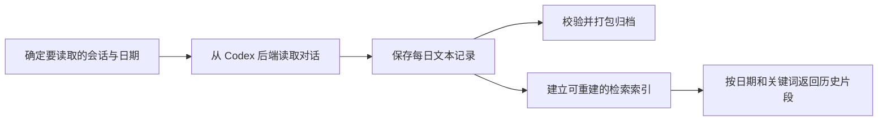

# MK · AI4Research — MQElite：保存并找回助手的历史对话

长期与 AI 协作时，对话会变长，也可能需要换一个会话。之前讨论过的决定、解释和背景，怎样保留下来，之后又怎样查到？

**MQElite 把选定的对话文本整理成每日记录，再提供按日期和关键词查找的能力。** 记录保存在可检查的本地文件中，检索结果有长度限制，便于助手取回相关历史。本版的归档与检索过程不调用模型，也不通过训练模型或生成摘要来代替原始记录。

它来自一套以 **Codex CLI 的 app-server** 为助手后端的个人系统。本仓库提供核心代码、合成数据演示与测试，**不是包含安装、调度和在线连接的完整记忆服务**。

## 它怎样保存和找回记录



每日文件是保存内容的依据；检索索引只是帮助查找的辅助结构。索引损坏可以重建，不应等于历史记录丢失。

保存范围是选定会话中符合条件的可见文本，并非所有工具输出、附件或内部事件。“这一天没有消息”和“这一天的历史没有读完整”也需要分别记录。检索能提供历史证据，但不意味着助手自动理解或记得所有旧内容。

## 哪些自建，哪些与 Codex 有关

| 部分 | 负责什么 | 对其他后端的适用性 |
| --- | --- | --- |
| **记录、归档与检索核心** | 每日文件格式、安全提交顺序、归档完整性检查、关键词索引和结果长度控制 | 主要处理本地记录，部分逻辑可在适配输入后沿用 |
| **Codex 读取适配** | 读取会话与回合，按日期筛选，并解释完成、中断和缺失时间戳 | 依赖 Codex app-server 的接口与数据含义，迁移时需替换并验证 |
| **主会话选择集成** | 利用自建 Router 的历史，确定每个助手在各时间段使用哪个主会话 | 依赖本系统的会话管理约定；完整适配器未包含在选段中 |
| **助手执行与原始会话** | 模型交互、工具执行和后端保存的原始对话 | 由上游 Codex 提供 |

因此，**MQElite 的归档与检索思路可以迁移，但当前代码不是任意聊天软件的数据导入器**。换后端仍需明确读取哪些内容、时间戳是什么意思、如何识别缺失记录，以及怎样把检索结果交回助手。

本仓库保留了读取算法，但用合成接口演示；真实在线传输、完整调度、面向助手的 CLI/MCP 服务及安装工具未收录。

## 按兴趣继续阅读

| 想了解什么 | 入口 |
| --- | --- |
| 记录、索引与 Codex、Router 的分工 | [架构与职责](docs/ARCHITECTURE.md) |
| 怎样按日期读取、处理中断并保留完整性证据？ | [核心机制](docs/MECHANISMS.md) |
| 每日记录的格式与时间边界 | [l2.py](src/mqelite/domain/l2.py)、[time_window.py](src/mqelite/domain/time_window.py) |
| 中途失败后怎样继续保存？ | [reconcile.py](src/mqelite/storage/reconcile.py) |
| 怎样打包并校验归档？ | [bundle.py](src/mqelite/archive/bundle.py) |
| 怎样查找中英文记录并控制返回量？ | [tokenize.py](src/mqelite/index/tokenize.py)、[service.py](src/mqelite/recall/service.py) |
| Codex 读取适配的代码 | [source.py](src/mqelite/codex/source.py) |

技术文档中的 **L2** 是本项目每日记录格式的名称；**词法召回**指按文本词项检索，不是向量相似度搜索。无需先理解这些术语才能运行下面的演示。

## 运行离线演示

需要 POSIX 系统、Python 3.11+、支持 FTS5 的 SQLite，以及 `Europe/London` 时区数据（用于日历与夏令时示例）。不需要 pip 依赖或模型凭证。

```sh
python3 -B scripts/demo.py
python3 -B scripts/check.py
```

演示用合成对话串联每日保存、检索与归档校验；检查脚本运行所选合成测试。两者使用自动清理的临时目录，不连接已有助手或读取私人记录。具体结果与限制见[验证记录](docs/VALIDATION.md)。

## 与整体系统的关系

- [MK_AI4Research-AgentSystem-Showcase](https://github.com/Mark-Ke-MA/MK_AI4Research-AgentSystem-Showcase)：展示人格规则、工作区以及权限、备份和清理等整体组织方式。
- [MK_AI4Research-Router-Showcase](https://github.com/Mark-Ke-MA/MK_AI4Research-Router-Showcase)：处理消息路由，并记录长期主会话更换前后的身份与时间区间。

MQElite 利用这些会话边界保存对话；本仓库的离线演示与测试不要求先安装另外两个项目。

## 来源与许可

这是 **2026-10-11** 整理的工程展示快照，采用人类主导、AI 辅助的开发方式。自建部分是记录选择、规范化、存储和检索机制；Codex、SQLite 及 Python 标准库分别提供底层运行和通用能力。选段与适配范围见[来源说明](docs/PROVENANCE.md)。

所选源码与源测试保留原有 MIT 声明，具体范围见[源码继承声明](docs/SOURCE_NOTICES.md)。本次新写材料没有新增整体复用授权，仓库未增加根级 LICENSE。
