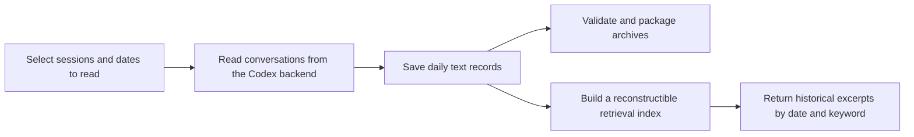

# MK · AI4Research — MQElite: Preserve and Retrieve an Assistant's Conversation History

[中文](README.md) | **English**

Long-running collaboration with AI produces long conversations, and sometimes requires moving to another session. How can earlier decisions, explanations, and context be preserved and found again?

**MQElite organizes selected conversation text into daily records and provides date- and keyword-based retrieval.** Records are stored in inspectable local files, and retrieval results have length limits so an assistant can recover relevant history. Archiving and retrieval in this edition do not call a model, train a model, or replace original records with generated summaries.

It comes from a personal system that uses the **Codex CLI app-server** as its assistant backend. This repository provides core code, synthetic-data demonstrations, and tests; **it is not a complete memory service with installation, scheduling, and live connectivity**.

## How Records Are Preserved and Retrieved



Daily files are the authority for preserved content; the retrieval index is only an aid to finding it. A damaged index can be rebuilt and should not mean that historical records are lost.

The preserved scope is eligible visible text from selected sessions, not all tool output, attachments, or internal events. “No messages on this day” and “This day's history was not fully read” also need to be recorded separately. Retrieval provides historical evidence; it does not mean an assistant automatically understands or remembers all previous content.

## Custom Mechanisms and Codex Dependencies

| Component | Responsibility | Applicability to other backends |
| --- | --- | --- |
| **Record, archive, and retrieval core** | Daily file format, safe commit ordering, archive integrity checks, keyword indexing, and result length limits | Primarily handles local records; some logic can be reused after adapting inputs |
| **Codex reading adapter** | Read sessions and turns, filter by date, and interpret completion, interruption, and missing timestamps | Depends on the Codex app-server interfaces and data semantics; must be replaced and validated when migrating |
| **Main-session selection integration** | Use the custom Router's history to determine which main session each assistant used during each interval | Depends on this system's session-management conventions; the complete adapter is not included in the excerpts |
| **Assistant execution and original sessions** | Model interaction, tool execution, and original conversations persisted by the backend | Provided by upstream Codex |

Thus, **MQElite's archiving and retrieval approach is transferable, but the current code is not a data importer for arbitrary chat software**. A backend change still requires specifying what to read, what timestamps mean, how missing records are identified, and how retrieval results are passed back to the assistant.

This repository retains the reading algorithm but demonstrates it with synthetic interfaces. Real live transport, complete scheduling, assistant-facing CLI/MCP services, and installation tools are not included.

## Further Reading

| Topic | Entry point |
| --- | --- |
| Responsibilities of records, indexes, Codex, and Router | [Architecture and responsibilities](docs_en/ARCHITECTURE.md) |
| Reading by date, handling interruptions, and preserving completeness evidence | [Core mechanisms](docs_en/MECHANISMS.md) |
| Daily record format and time boundaries | [l2.py](src/mqelite/domain/l2.py), [time_window.py](src/mqelite/domain/time_window.py) |
| Resuming persistence after a partial failure | [reconcile.py](src/mqelite/storage/reconcile.py) |
| Packaging and validating archives | [bundle.py](src/mqelite/archive/bundle.py) |
| Retrieving Chinese and English records and bounding results | [tokenize.py](src/mqelite/index/tokenize.py), [service.py](src/mqelite/recall/service.py) |
| Codex reading adapter code | [source.py](src/mqelite/codex/source.py) |

In the technical documentation, **L2** is the name of this project's daily record format; **lexical recall** means retrieval by textual terms, not vector-similarity search. Neither term is a prerequisite for running the demonstration below.

## Run the Offline Demonstration

Requires a POSIX system, Python 3.11+, SQLite with FTS5 support, and `Europe/London` time-zone data for calendar and daylight-saving examples. No pip dependencies or model credentials are required.

```sh
python3 -B scripts/demo.py
python3 -B scripts/check.py
```

The demonstration connects daily persistence, retrieval, and archive validation using synthetic conversations; the check script runs the selected synthetic tests. Both use automatically cleaned temporary directories, without connecting to existing assistants or reading private records. See the [validation record](docs_en/VALIDATION.md) for results and limitations.

## Relationship to the Overall System

- [MK_AI4Research-AgentSystem-Showcase](https://github.com/Mark-Ke-MA/MK_AI4Research-AgentSystem-Showcase/blob/main/README_en.md): presents persona rules, workspaces, and the overall organization of permissions, backups, and cleanup.
- [MK_AI4Research-Router-Showcase](https://github.com/Mark-Ke-MA/MK_AI4Research-Router-Showcase/blob/main/README_en.md): handles message routing and records identities and time intervals around changes to long-lived main sessions.

MQElite uses these session boundaries to preserve conversations. This repository's offline demonstration and tests do not require installing either of the other projects first.

## Provenance and Licensing

This is an engineering showcase snapshot assembled on **2026-10-11**, developed through human-led, AI-assisted work. The custom contributions are record selection, normalization, storage, and retrieval mechanisms; Codex, SQLite, and the Python standard library provide the underlying runtime and general-purpose capabilities. See [provenance](docs_en/PROVENANCE.md) for excerpt and adaptation boundaries.

Selected source code and source tests retain their original MIT notice; see [source notices](docs_en/SOURCE_NOTICES.md) for its exact scope. No additional repository-wide reuse permission is granted for newly written materials, and no root-level LICENSE has been added.
