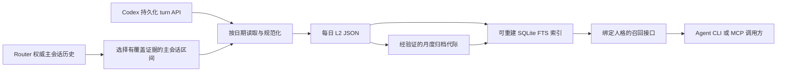

# 架构与职责边界

**中文** | [English](../docs_en/ARCHITECTURE.md)

图中呈现完整私人系统设计。本仓库保留每日记录模型、轮询算法、存储与提交原语、归档包、索引和召回服务。Router 历史适配器、真实 RPC 传输、每日及多人格调度、完整归档与索引生命周期、CLI/MCP 服务和安装工具不在可运行选段内。

## 权威记录与派生状态

每日 L2 JSON 是记忆记录的权威来源。“L2”是项目格式名，不代表向量索引或模型层级。它保存有序的可见对话片段、记忆日期、人格身份，以及可选的显式部分日期覆盖范围。压缩归档保存这些原始字节。

摄取账本与召回索引属于可重建状态。丢失索引不应等于丢失记录。提交顺序是先写 JSON、再记状态，因此前次文件提交成功但状态更新失败时，重试能够修复账本。生产编排负责提供重建输入并调用这些机制。

这里“无损”的范围是所选可见文本及 L2 原始字节在这些阶段得到保留；它不意味着所有内部模型事件、工具输出、附件或任意对话都进入档案。读取器按权威主会话区间选择可见 user/assistant 文本。

## 三类证据边界

**身份。** 生产流水线从 Router 权威历史获取主会话区间，不从最近会话列表猜测 main。这里的读取器核对 main 与配置的人格一致。演示用的 fake RPC 只是合成协议夹具，不具备生产身份权威。

**时间。** 记忆日默认是 Europe/London 当地 03:00 到次日 03:00 的左闭右开区间，实际可能跨越 23 或 25 小时。原生格式严格记录覆盖语义；初始化首日的部分覆盖有显式标记。“完整覆盖但没有消息”和“缺少历史”是不同状态。

**精度。** 活动 turn 中稳定的用户输入可以进入记录；中断后没有完成时间的助手内容可以作为仅有日期精度的证据保留。精确时段召回排除这类内容，不伪造完成时间。

原生片段使用持久化 turn 的开始时间标记用户内容、完成时间标记助手内容；这不是每条消息独立采集的发送时间。

## 隔离与运行范围

数据根目录必须显式给出。每个人格有自己的目录和读取索引；召回接口绑定该索引，不在每次请求时接受任意人格选择。源标识使用配置密钥参与的 BLAKE2b 摘要，它不是对话内容加密。

这些实现补充主机权限和调用方绑定，不构成多租户安全认证。拥有足够文件系统权限的进程仍可能读取底层材料。公开测试只验证临时目录内的具体不变量和路径检查。

生产系统分离代码版本、配置、数据、writer 调度和 recall 进程，使只升级 writer 而不同时升级所有 recall 服务成为可能。本快照不对主机当前部署与调度健康状况作实时证明。
