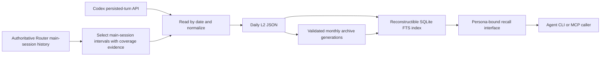

# Architecture and Responsibility Boundaries

[中文](../docs/ARCHITECTURE.md) | **English** | [Overview](../README_en.md)

The diagram presents the complete private system design. This repository retains the daily record model, polling algorithm, storage and commit primitives, archive bundles, index, and recall service. The Router history adapter, real RPC transport, daily and multi-persona scheduling, complete archive and index lifecycles, CLI/MCP services, and installation tools are outside the runnable excerpts.

## Authoritative Records and Derived State

Daily L2 JSON is the authoritative source of memory records. “L2” is a project format name, not a vector index or model tier. It preserves ordered visible conversation segments, a memory date, persona identity, and optional explicit partial-day coverage. Compressed archives preserve these original bytes.

The ingestion ledger and recall index are reconstructible state. Losing an index should not mean losing records. Commits write JSON before recording state, so a retry can repair the ledger when the previous file commit succeeded but the state update failed. Production orchestration supplies reconstruction inputs and invokes these mechanisms.

Here, “lossless” means selected visible text and original L2 bytes are preserved through these stages; it does not mean that every internal model event, tool output, attachment, or arbitrary conversation enters the archive. The reader selects visible user/assistant text according to authoritative main-session intervals.

## Three Evidence Boundaries

**Identity.** The production pipeline obtains main-session intervals from authoritative Router history, rather than guessing the main from a recent-session list. The reader here checks that the main belongs to the configured persona. The demonstration's fake RPC is only a synthetic protocol fixture and has no production identity authority.

**Time.** By default, a memory day is the half-open interval from 03:00 local time in Europe/London to 03:00 the next day; it can span 23 or 25 hours. The native format strictly records coverage semantics, and partial coverage on the initialization day is explicitly marked. “Complete coverage with no messages” and “Missing history” are different states.

**Precision.** Stable user input from an active turn can enter records; assistant content without a completion time after interruption can be preserved as evidence with day-level precision only. Exact-time-range recall excludes such content rather than fabricating completion timestamps.

Native segments timestamp user content with the persisted turn's start time and assistant content with its completion time. These are not independently captured send times for each message.

## Isolation and Operational Scope

The data root must be explicitly supplied. Each persona has its own directory and read index; the recall interface is bound to that index and does not accept arbitrary persona selection on each request. Source identifiers use BLAKE2b digests incorporating a configured key; this is not conversation-content encryption.

These implementations complement host permissions and caller binding; they do not constitute multi-tenant security authentication. A process with sufficient filesystem permissions can still read the underlying material. Public tests verify only specific invariants and path checks within temporary directories.

The production system separates code versions, configuration, data, writer scheduling, and recall processes, allowing the writer to be upgraded without simultaneously upgrading every recall service. This snapshot does not provide live proof of the host's current deployment or scheduling health.
